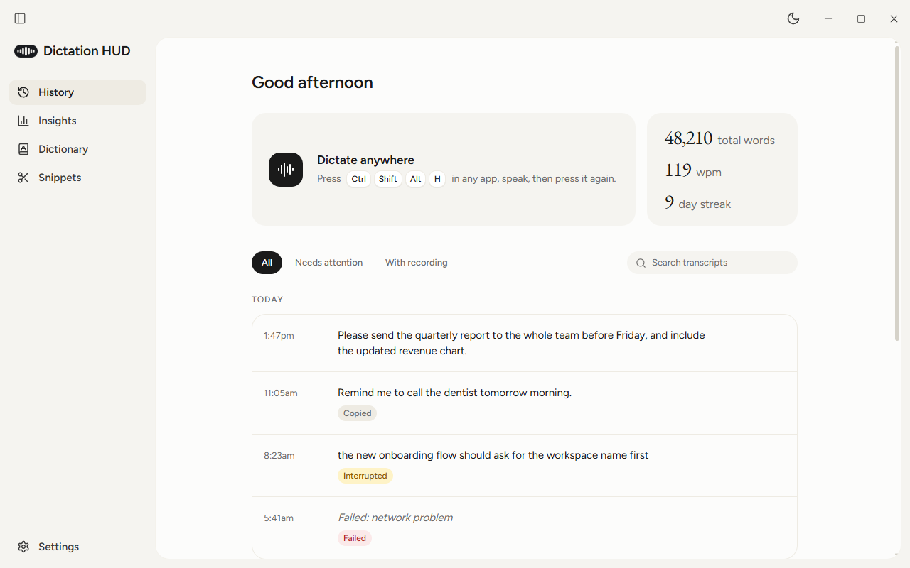
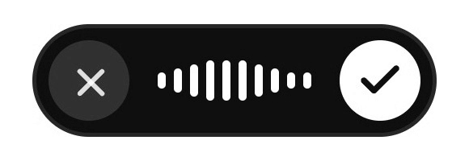
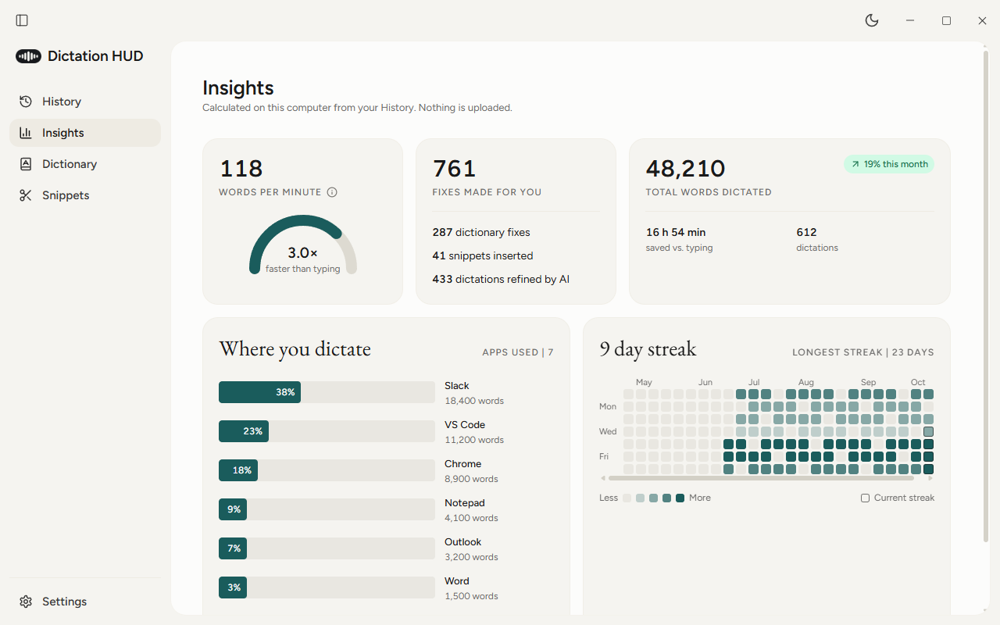
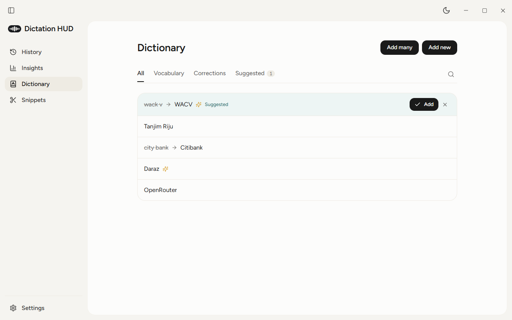
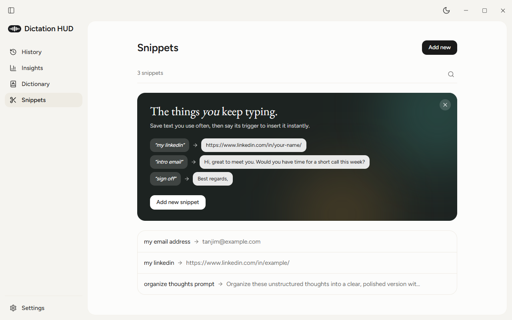
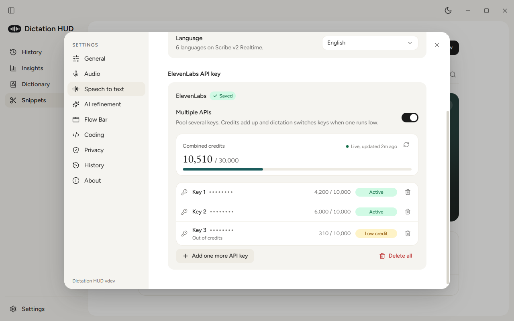
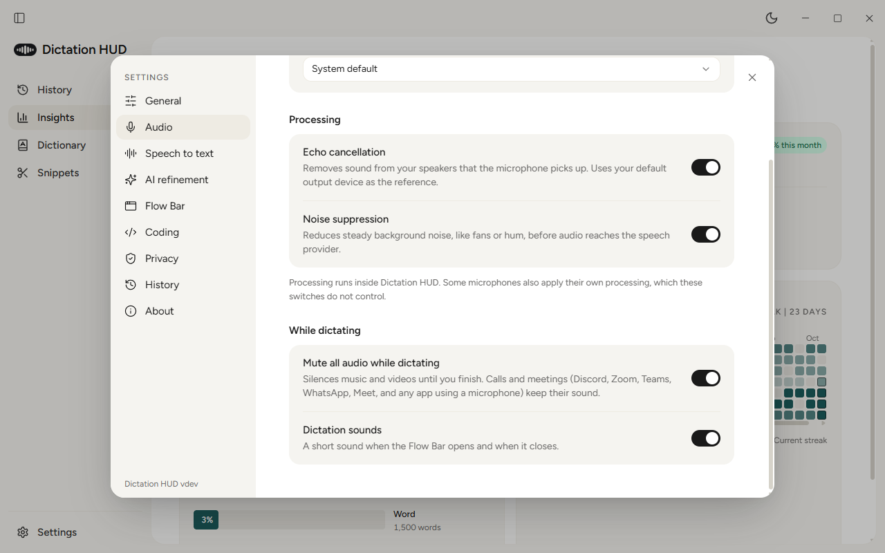
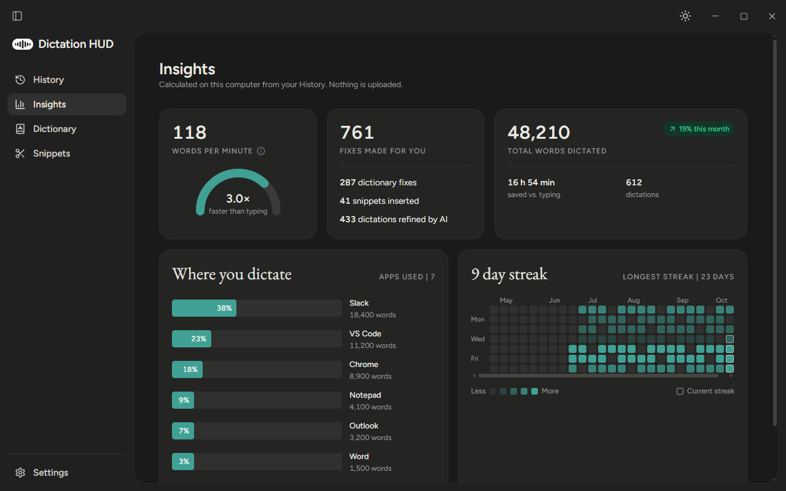
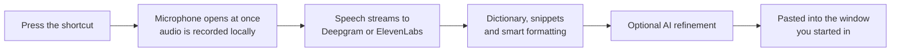

<div align="center">

<picture>
  <source media="(prefers-color-scheme: dark)" srcset="assets/readme/logo-light.png">
  
</picture>

# Dictation HUD

**Speak anywhere on Windows. Your words land where you were typing, cleaned up and formatted.**

An open source alternative to Wispr Flow, built with Tauri 2, Rust and React.

[](https://github.com/Tanjim-Islam/Dictation-HUD/releases/latest)
[](https://github.com/Tanjim-Islam/Dictation-HUD/releases)
[](#install)
[](https://tauri.app)
[](src-tauri)

[**Download**](https://github.com/Tanjim-Islam/Dictation-HUD/releases/latest) &nbsp;·&nbsp; [Features](#features) &nbsp;·&nbsp; [How it works](#how-it-works) &nbsp;·&nbsp; [Privacy](#privacy) &nbsp;·&nbsp; [Development](#development)

<br>

<picture>
  <source media="(prefers-color-scheme: dark)" srcset="assets/readme/home-dark.png">
  
</picture>

</div>

<br>

## The Flow Bar

Press the shortcut in any app and a small bar appears at the edge of your screen. It shows a live waveform while you speak, and never takes focus from the app you are typing in. Press the shortcut again, or click the check, and your text is pasted right where you left off.

<div align="center">

<picture>
  <source media="(prefers-color-scheme: dark)" srcset="assets/readme/flowbar-dark.gif">
  
</picture>

<sub>Cancel on the left, finish on the right. Dock it to the top, bottom, left or right of the screen.</sub>

</div>

## Features

<table>
<tr>
<td width="50%" valign="top">

### 🎙️ Dictate anywhere
One global shortcut (default <kbd>Ctrl</kbd> <kbd>Shift</kbd> <kbd>Alt</kbd> <kbd>H</kbd>) starts and finishes dictation in any app. Short open and close sounds tell you it heard you, and other apps' audio is muted while you talk. Calls and meetings keep their sound.

</td>
<td width="50%" valign="top">

### 🛡️ Safe delivery
Text is pasted only into the window you started in. If you switched apps or tabs, or the window closed, the text is copied to the clipboard instead and the app tells you why.

</td>
</tr>
<tr>
<td valign="top">

### ⚡ Fast, accurate speech to text
Deepgram (Nova-3, 70+ languages including Bengali) or ElevenLabs (Scribe v2 Realtime). Pool many ElevenLabs keys: credits add up, working keys go first, and if a key is refused mid-sentence the app switches keys without losing a word.

</td>
<td valign="top">

### ✨ AI refinement
Optional cleanup of punctuation, grammar and filler words with an OpenRouter or MegaLLM model. If the model is slow or fails, the formatted transcript is used, so nothing is lost.

</td>
</tr>
<tr>
<td valign="top">

### 🕘 History that keeps everything
Every dictation is saved on your computer with its recording. Play it back, copy it, retry the transcript or the refinement, recover an interrupted dictation, or export a WAV.

</td>
<td valign="top">

### 📖 Dictionary and snippets
Teach it names and terms, fix words it keeps mishearing, and say a short trigger to insert saved text exactly as written. It even suggests entries when you fix a word right after dictating.

</td>
</tr>
<tr>
<td valign="top">

### 💻 Made for coding too
In editors and terminals, say "camel case get user name" for `getUserName`, plus snake, pascal, kebab and constant case. Terminal commands keep a lowercase first word and no trailing period.

</td>
<td valign="top">

### 🌗 Light and dark
A calm, warm interface with Light, Dark and System themes, from the title bar or Settings. The tray and taskbar icons follow your Windows taskbar theme.

</td>
</tr>
</table>

## A closer look

<table>
<tr>
<td width="50%" align="center">
<br>
<sub><b>Insights.</b> Words per minute, time saved, the apps you dictate in, and your streak. Calculated on your computer.</sub>
</td>
<td width="50%" align="center">
<br>
<sub><b>Dictionary.</b> Vocabulary, corrections for misheard words, and suggestions learned from your fixes.</sub>
</td>
</tr>
<tr>
<td align="center">
<br>
<sub><b>Snippets.</b> Say "my linkedin" and the full link is typed for you.</sub>
</td>
<td align="center">
<br>
<sub><b>Key pool.</b> Add many ElevenLabs keys at once and watch the combined credits live.</sub>
</td>
</tr>
<tr>
<td align="center">
<br>
<sub><b>Audio.</b> Echo cancellation and noise suppression in Rust, plus muting and dictation sounds.</sub>
</td>
<td align="center">
<br>
<sub><b>Dark mode.</b> Every screen, in both themes.</sub>
</td>
</tr>
</table>

## How it works



1. **Press the shortcut.** The microphone opens first, so nothing you say at the start is lost, and the recording is saved locally from the first moment.
2. **Speak.** Audio streams to your speech provider from Rust. No API key ever reaches the app's web views.
3. **Press it again.** Your dictionary corrections, snippets and spoken commands like "new line" are applied, then optional AI refinement.
4. **Done.** The text is pasted into the app you were using, or copied with a clear reason if that app is gone.

## Privacy

- 🔐 **Keys stay in Windows Credential Manager.** They never reach the web views and are never written to logs.
- 💾 **Your data stays on your computer.** Transcripts, recordings and your dictionary live in your app data folder (SQLite and Opus files). Recordings are kept 14 days by default; transcripts are kept.
- 📡 **Only what you choose leaves.** Audio goes to the speech provider you pick. Text goes to an AI provider only when AI refinement is on.
- 🚫 **Never from secure fields.** The optional context awareness never reads password or PIN fields, and that text is never saved.

## Install

1. Download the latest installer from [**Releases**](https://github.com/Tanjim-Islam/Dictation-HUD/releases/latest).
2. Open **Settings**, choose Deepgram or ElevenLabs, and add an API key.
3. Press <kbd>Ctrl</kbd> <kbd>Shift</kbd> <kbd>Alt</kbd> <kbd>H</kbd> in any app and start talking.

Updates are signed and install from inside the app when a new version is out.

> [!TIP]
> Using many free ElevenLabs accounts from one network can get them flagged for "unusual activity". Those keys still show full credit but are refused for live transcription. Dictation HUD sets such keys aside automatically and tells you why in Settings; a paid plan on the account fixes it.

## Development

<details>
<summary><b>Run it locally</b></summary>

<br>

Prerequisites: Windows 10 or 11, Node 20+, Rust stable, CMake and Ninja (for the bundled Opus encoder), and the WebView2 runtime.

```powershell
npm ci
npm run dev              # the app with hot reload
npm run dev:frontend     # the UI only, in a browser, with a mocked backend
```

Development builds can read API keys from a `.env` file at the repo root (`DEEPGRAM_API_KEY`, `ELEVENLABS_API_KEY`, `OPENROUTER_API_KEY`, `MEGALLM_API_KEY`). Release builds never read `.env`; add keys in Settings.

</details>

<details>
<summary><b>Checks (the same ones CI runs)</b></summary>

<br>

```powershell
npm run check:versions
npm run typecheck
npm run lint
npm test
npm run build:frontend
cargo fmt --manifest-path src-tauri/Cargo.toml --check
cargo clippy --manifest-path src-tauri/Cargo.toml --all-targets -- -D warnings
cargo test --manifest-path src-tauri/Cargo.toml
npx tauri build --no-bundle
```

</details>

<details>
<summary><b>Releases</b></summary>

<br>

Signed installers are built by the release workflow when a `v<version>` tag is pushed. The version in `package.json`, `package-lock.json`, `src-tauri/Cargo.toml`, `src-tauri/Cargo.lock` and `src-tauri/tauri.conf.json` must match the tag.

</details>

<details>
<summary><b>Project layout</b></summary>

<br>

```text
src/            React UI: History, Insights, Dictionary, Snippets, Settings, Flow Bar
src-tauri/src/  Rust: session state machine, audio engine, providers and key pool,
                delivery, text pipeline, history database, tray, updates
```

</details>

<div align="center">
<br>
<sub>Made for people who think faster than they type.</sub>
</div>
